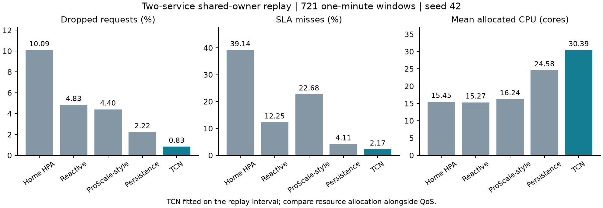

# Caling Beyond Home: Proactive Microservice Autoscaling with Neighboring Edge Resources

Research implementation and experimental artifact for the thesis paper.
The project studies how forecast
demand, vertical and horizontal elasticity, and resource sharing among nearby
clusters affect service quality and resource allocation.

This repository contains the research controllers and evaluation workflows.
This repository also includes the simulator snapshot used by the thesis.
The curated simulator-only release is maintained in
[ECTLab/HierarchicalEdgeSim](https://github.com/ECTLab/HierarchicalEdgeSim), which
has its own IKT paper. The simulator is one supporting contribution; this
repository presents the broader autoscaling research.

**Status:** private research artifact under preparation. A thesis/paper link,
final contribution statements, and numbered
paper-figure mappings will be added when that manuscript is ready.

## Research implemented here

- Forecast-driven scaling decisions using recent observations and a prediction
  horizon, with persistence and per-service residual TCN predictors.
- A shared allocation policy that combines vertical resizing, local replica
  placement, and capacity sharing with neighboring clusters.
- Worker ownership, reserve checks, resource reclamation, and return-to-home
  behavior for borrowed capacity.
- Controlled comparisons against the reactive allocation policy, home-cluster
  HPA, and a reduced ProScale-style baseline.
- Trace-driven experiments with two, four, and eight microservices, including
  a two-service experiment with separate home clusters.

These describe the implemented research components. Formal novelty claims and
their boundaries belong in the thesis/paper and will be aligned with its final
evaluation.

## Relationship to the simulator

This is the original integrated research repository, renamed while preserving
its history. Its thesis baseline is commit
`2021f17f0346153f7df31680d2fc92d75597b5fa`; research development continues from
that point. It includes the environment, resource/latency model, reference and
research controllers, forecasting, scenarios, checkpoints, and analysis.

The Python namespace remains `hierarchical_edge_sim`: environment code lives in
`src/hierarchical_edge_sim/env/` and controllers in
`src/hierarchical_edge_sim/autoscaler/`. Install this checkout directly; no
separate simulator package is required.

The later IKT work is retained on the private `ikt` branch at `82553f6`.
ECTLab's clean simulator release is `1633f4b` (`ikt-2026`), prepared from that
IKT work with thesis material excluded. It has independent public history.
See [repository maintenance](docs/REPOSITORY-MAINTENANCE.md) for the branch and
publishing workflow. The thesis and IKT branches are not merged together.

## Quick start

Use Python 3.12 or newer and Git. Run commands from the repository root:

```bash
python3 -m venv .venv
source .venv/bin/activate
python -m pip install -e '.[dev,plot]'
python examples/run_with_autoscaler.py configs/11-demo_60_proactive.yaml
python -m pytest -q
```

This small persistence-based example does not need PyTorch. For the TCN models:

```bash
python -m pip install -e '.[tcn]'
```

Checkpoints are loaded on CPU. If the virtual-environment command reports that
`ensurepip` is unavailable on Ubuntu, install the matching `python3-venv`
package before creating the environment.

## Evaluation and results



This figure summarizes a fresh replay of the two-microservice shared-owner
scenario using the thesis simulator snapshot and supplied configurations. It compares
drop rate, SLA-miss rate, and mean allocated CPU. It includes all 721 windows,
including the proactive controller's cold-start period. The TCN checkpoints
were fitted on the same trace interval: these are **same-trace replay results**,
not evidence of forecasting generalization to unseen data. Resource allocation
differs across policies and should be considered alongside QoS.

Compact reference results, environment details, and input checksums are in
[`results/reference/two-ms/`](results/reference/two-ms/). They can be regenerated:

```bash
python experiments/run_campaign.py --campaign two-ms --include-tcn
```

Omit `--include-tcn` for the four policies that do not require PyTorch. The runner
writes raw logs and a summary under `results/two-ms/`. It checks conservation of
offered requests and produces `summary.csv`, `provenance.json`, and a comparison
figure. This is a lightweight local simulation; measured execution time is
recorded in provenance rather than promised for other machines.

Other experiment groups use the same runner:

```bash
python experiments/run_campaign.py --campaign split-owner --include-tcn
python experiments/run_campaign.py --campaign four-ms --include-tcn
python experiments/run_campaign.py --campaign eight-ms --include-tcn
```

The groups correspond to configs 33–37, 50–54, 38–42, and 43–47 respectively.
Configs 48–49 provide a two-service target-utilization sensitivity variant.
See [the experiment guide](docs/EXPERIMENTS.md) for scope, metric definitions,
individual runs, and analysis commands. These are experiment groups, not a
claim that the current thesis manuscript has finalized these as its figures.

## Repository contents

- `src/hierarchical_edge_sim/env/`: the integrated simulation environment.
- `src/hierarchical_edge_sim/autoscaler/`: research policies, predictors, shared
  helpers, and reference controllers.
- `configs/`: synthetic checks and Alibaba evaluation scenarios.
- `traces/`: synthetic workloads and processed Alibaba request-count series.
- `models/`: checkpoint weights and architecture/preprocessing metadata.
- `experiments/`: reproducible campaign runner and summary plotting.
- `examples/analysis/`: per-run and multi-policy analysis tools.
- `tests/`: research policy, predictor, loader, and analysis checks.
- `results/reference/`: small recorded reference summaries and provenance.

## Scope and limitations

Evaluation uses the simulator's independent decision windows, analytical
latency, static network delays, and configurable resource floors. It is not
a physical Kubernetes deployment or a validation of the simulator against one.
The ProScale-style implementation is a reduced comparison baseline, not the
original authors' full system. Supplied TCN checkpoints enable inference/replay;
their training pipeline is not yet packaged here. Same-trace fitting and
different policy resource budgets must be considered when interpreting results.

## Citation and publication

Software citation metadata is in `CITATION.cff`. The thesis/paper is not linked
until its final public version is available. Cite the research manuscript for
the autoscaling method, and the separate HierarchicalEdgeSim paper when using
or discussing the simulation platform. Neither citation substitutes for the
other.

Dataset attribution is in [traces/README.md](traces/README.md). The public ECTLab
simulator release has an MIT license. Licensing of this private research artifact
will be settled before a public release.
